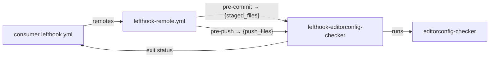
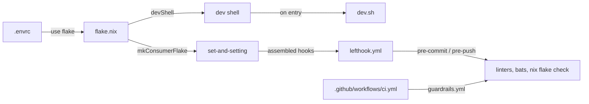

# nix-lefthook-editorconfig-checker

<!-- hallucinogen:autonomy-disclaimer start -->
> Read [LLM-DISCLAIMER](docs/LLM-DISCLAIMER.md) first. This repository is
> tended by an autonomous loop, and that file says what the loop may do here,
> what it may not, and what to check before trusting anything in this tree.
<!-- hallucinogen:autonomy-disclaimer end -->

[](https://github.com/pr0d1r2/nix-lefthook-editorconfig-checker/actions/workflows/ci.yml) [](https://nixos.org)

> This code is LLM-generated and validated through an automated integration process using [lefthook](https://github.com/evilmartians/lefthook) git hooks, [bats](https://github.com/bats-core/bats-core) unit tests, and GitHub Actions CI.

Lefthook-compatible [editorconfig-checker](https://github.com/editorconfig-checker/editorconfig-checker) wrapper, packaged as a Nix flake.

Validates files against `.editorconfig` rules (indentation, charset, line endings, trailing whitespace, final newline). Filters non-existent files from staged arguments and checks the rest. Exits 0 when no files are found.

## Architecture



## Usage

### Option A: Lefthook remote (recommended)

Add to your `lefthook.yml` — no flake input needed, just `pkgs.editorconfig-checker` in your devShell:

```yaml
remotes:
  - git_url: https://github.com/pr0d1r2/nix-lefthook-editorconfig-checker
    ref: main
    configs:
      - lefthook-remote.yml
```

### Option B: Flake input

Add as a flake input:

```nix
inputs.nix-lefthook-editorconfig-checker = {
  url = "github:pr0d1r2/nix-lefthook-editorconfig-checker";
  inputs.nixpkgs.follows = "nixpkgs";
};
```

Add to your devShell:

```nix
nix-lefthook-editorconfig-checker.packages.${pkgs.stdenv.hostPlatform.system}.default
```

Add to `lefthook.yml`:

```yaml
pre-commit:
  commands:
    editorconfig-checker:
      run: timeout ${LEFTHOOK_EDITORCONFIG_CHECKER_TIMEOUT:-30} lefthook-editorconfig-checker {staged_files}
```

### Configuring timeout

The default timeout is 30 seconds. Override per-repo via environment variable:

```bash
export LEFTHOOK_EDITORCONFIG_CHECKER_TIMEOUT=60
```

## Development

The repo includes an `.envrc` for [direnv](https://direnv.net/) — entering the directory automatically loads the devShell with all dependencies:

```bash
cd nix-lefthook-editorconfig-checker  # direnv loads the flake
bats tests/unit/
```

If not using direnv, enter the shell manually:

```bash
nix develop
bats tests/unit/
```

### Development architecture



## License

MIT
